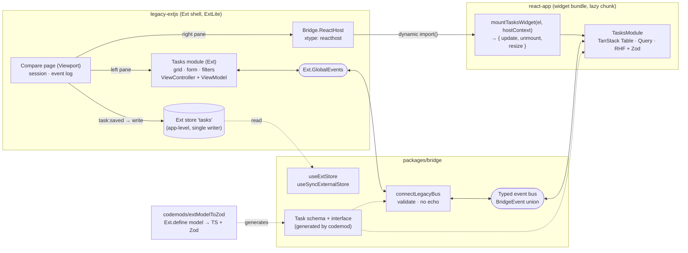

# Ext JS → React: a strangler-fig migration

A working, test-covered model of how a large Ext JS application is moved to React **one module at a time while the legacy shell stays in production**. The Ext shell keeps owning login, routing, the z-index stack and global events; React modules are mounted inside it behind per-module feature flags and can be flipped back without a deploy.

It is small enough to read in an afternoon but uses the same seams as a real migration: a lifecycle-aware host component, a typed event bus with a legacy adapter, a store adapter for the coexistence period, generated data contracts with a drift guard, CSS and z-index isolation, and a flag router with a kill switch.

> The playbook behind the code: **[docs/MIGRATION_PLAYBOOK.md](docs/MIGRATION_PLAYBOOK.md)**

## Architecture



## Repository layout

```
extjs-to-react-migration/
├─ legacy-extjs/            Ext-style app served by Vite
│  ├─ src/extlite/          ExtLite: Ext.define/config/mixins/callParent, Observable, Store/Model/proxy,
│  │                        Component/Container/Panel/Toolbar/fields/Form/Grid/Viewport, ViewModel, ViewController
│  ├─ src/app/              Compare page, Tasks (grid + form + filter toolbar), bridge wiring
│  └─ public/api/tasks.json Mock backend shared by both UIs
├─ react-app/               Vite + React 18 + TypeScript (strict)
│  ├─ src/main.tsx          Standalone app
│  ├─ src/widget.tsx        Library entry: mountTasksWidget / mountTaskSummaryWidget
│  └─ src/tasks/            TanStack Table grid, TanStack Query data layer, React Hook Form + Zod form
├─ packages/bridge/         Interop layer (framework-free entry + /react entry)
│  ├─ src/reactHost.ts      Bridge.ReactHost Ext component (mount, props, resize, destroy, late-load guard)
│  ├─ src/eventBus.ts       Typed bus; src/legacyBus.ts maps Ext string events ↔ typed events
│  ├─ src/useExtStore.ts    Read a legacy Ext store from React
│  ├─ src/featureFlags.ts   Per-module legacy/react resolution with reasons
│  ├─ src/contracts/        BridgeEvent union, HostContext, generated Task contract
│  └─ locales/              Shared i18n catalog (legacy keys reused verbatim)
├─ codemods/                Ext.define model → TypeScript interface + Zod schema (TS compiler API)
└─ docs/MIGRATION_PLAYBOOK.md
```

## Running it

Requires Node 20.19+ (developed on Node 24 / npm 11).

```bash
npm install

# Legacy Ext shell, which also hosts the React widget (builds the widget bundle first)
npm run dev:legacy          # http://localhost:5173

# React module on its own
npm run dev:react           # http://localhost:5174
```

The shell consumes the widget as a built artifact, the same way it would consume a separately deployed bundle. After changing React code, run `npm run build:widget -w @migration/react-app` (or develop in `dev:react`, which has HMR).

### The demo page

Open `http://localhost:5173` (the dev server port can differ; see the terminal). One page, two panes:

| Left: **Before** | Right: **After** |
| --- | --- |
| The original Ext JS screen: `Ext.define` classes, an `Ext.data.Store`, ViewModel `bind`, a ViewController | The React rewrite: TanStack Query, TanStack Table, React Hook Form + Zod |
| Rendered by Ext as `xtype: 'tasks-main'` | Rendered inside the same Ext page by `xtype: 'reacthost'`, which lazy-loads `mountTasksWidget` |

Both sides share one session and one typed event bus, so they stay in sync:

* Click a row on either side and the same task is selected on the other (`taskselect` ↔ `task:selected`).
* Save a task on either side and the other grid and form update. The shell is the single writer of the shared Ext store.
* The status bar shows the last bridge event and which framework sent it.
* Edit a task in React, then click another row: the React confirm dialog stacks above Ext using the shell's z-index manager.
* `?lang=de` switches both frameworks to the German catalog.

In production the same host component sits behind the per-module feature-flag router in `packages/bridge` (`?ui=react|legacy`, localStorage, kill switch), so each screen is flipped on its own. The demo shows both versions at once instead.

### Production builds

```bash
npm run build               # bridge (tsc) → react-app (app + widget library) → legacy-extjs
npm run preview:legacy      # http://localhost:4173
```

`react-app` builds twice: `dist/` (standalone) and `dist-widget/tasks-widget.js` (`vite build --mode widget`, React bundled in, CSS inlined). The legacy build pulls the widget in as a lazy chunk, so Ext-only users never download React.

## Quality gates

```bash
npm run lint        # ESLint 9 flat config, typescript-eslint strict, react-hooks
npm run typecheck   # tsc --noEmit per workspace (strict, noUncheckedIndexedAccess)
npm test            # Vitest in every workspace (jsdom where needed)
npm run build
npm run codegen     # regenerate the Task contract from the Ext model
```

| Suite | Covers |
| --- | --- |
| `packages/bridge/test` | event bus semantics and type narrowing, legacy adapter (validation, echo suppression, disconnect), `useExtStore` reactivity and cleanup, `Bridge.ReactHost` mount/update/resize/destroy/late-load/error, feature-flag precedence, contract and i18n parity |
| `codemods/test` | model extraction, emitted schema/interface/defaults, schema behaviour, **drift guard** against the checked-in contract, failure on non-literal bodies |
| `react-app` | Tasks module: sorting parity, filters, cross-UI search, validation messages, save events, legacy-originated saves, unsaved-change confirm, error state; widget entry points: mount, update, style ref-counting, unmount, legacy store summary |
| `legacy-extjs/test` | ExtLite class system, data package, MVVM bindings, ViewController listen domains, grid, destroy cleanup |

## The migration story

The application this models was a multi-year Ext JS product (Ext 4 → 6 → 7, Sencha Cmd, a few hundred view classes). A rewrite was never on the table: the business could not freeze features, and the Ext code carried a decade of edge cases nobody had written down.

1. **Inventory.** Parsing every `Ext.define` produced a class graph with `xtype`, store, controller and global-event edges. It showed which screens were leaves and where `ComponentQuery` and `GlobalEvents` hid coupling.
2. **Platform seams first.** Before any React screen shipped, the shell gained a host component, a typed event bus with an Ext adapter, a flag router with a kill switch, shared session handling, design tokens and a z-index handshake. The first React release was a read-only dashboard that read Ext stores directly.
3. **Contracts from the source of truth.** Models were converted to TypeScript + Zod by codemod, and a drift test made any Ext model change fail CI until the React side caught up.
4. **Leaf by leaf.** CRUD screens moved next, each behind its own flag: internal URL flag, opt-in toggle, cohort default, everyone, then deletion of the Ext classes. Parity details (null sorting, local dates, validation text, column formats) were treated as bugs, not polish.
5. **Strangling the shell.** Once modules no longer needed Ext data, the shell's routing and layout were the last pieces to go.

The code here keeps every one of those seams, at a size you can read end to end.

## Notable decisions

* **ExtLite instead of Ext JS.** Ext JS is commercial and not usable from npm, so `legacy-extjs/src/extlite` re-implements the parts a migration has to deal with (class system with `config`/`apply`/`update`, `callParent`, mixins, observable events, stores with proxies, MVVM binding, controller `listen` domains, grid/form components) with matching semantics, including the awkward ones (renderers returning HTML, records mutating in place, define-time evaluation).
* **Framework-agnostic host contract.** The shell only knows `(el, props) => { update, unmount, resize }`, so it never imports React and the widget bundle can be versioned and deployed separately.
* **Explicit `HostContext`.** Widgets receive bus, session, translator, API base URL, z-index allocator and legacy stores as props. No widget reads Ext globals, which is what makes the standalone app and the tests possible.
* **Generated contracts with a drift guard** instead of hand-written duplicate types.
* **Each widget mount owns its QueryClient** to avoid accidental cache sharing between independently mounted modules; cross-module consistency goes through bus events.
* **Single writer** for legacy data during coexistence: the shell controller applies `task:saved` to the Ext store, whichever UI produced it.
* **Bridge consumed from source** via Vite aliases in app, widget and tests, so nothing depends on a stale `dist/`. `tsc` still builds the package for publishing.

## License

MIT
